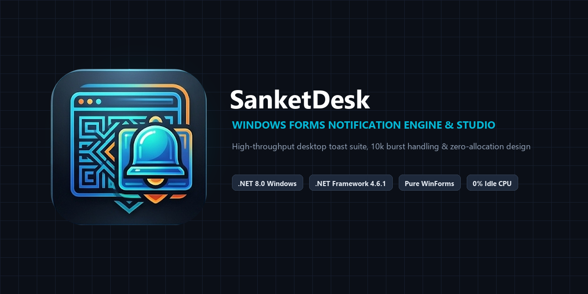
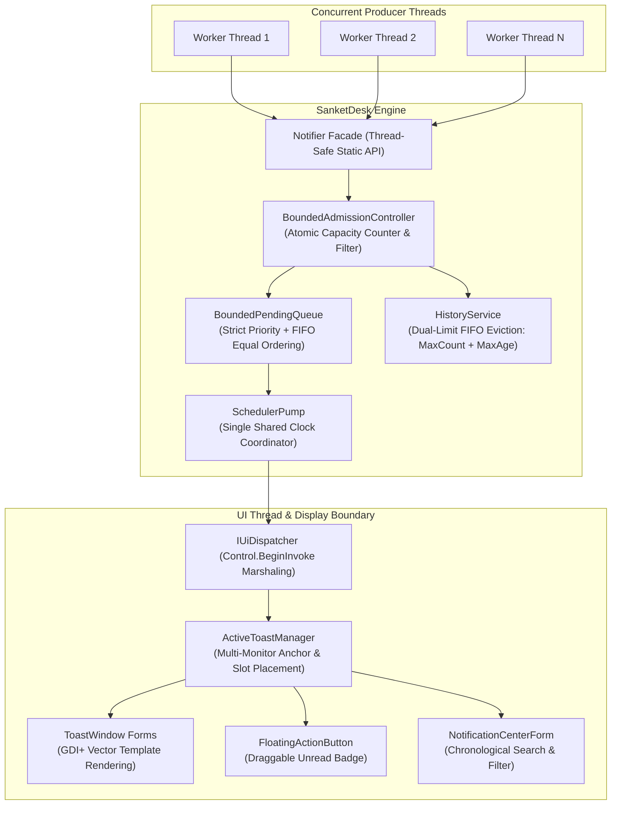

# SanketDesk

**High-performance, pure Windows Forms desktop notification library, toast engine, and interactive configurator studio.**

[](#supported-frameworks)
[](LICENSE)
[](https://www.nuget.org/packages/SanketDesk.Net8/)

**Repository:** [GitHub](https://github.com/hiteshbhanushali-techmaster/SanketDesk) · **NuGet:** [SanketDesk.Net8](https://www.nuget.org/packages/SanketDesk.Net8/) · [SanketDesk.NetFramework](https://www.nuget.org/packages/SanketDesk.NetFramework/) · **Documentation:** [Project Site](https://hiteshbhanushali-techmaster.github.io/SanketDesk/) · [Common Questions](https://hiteshbhanushali-techmaster.github.io/SanketDesk/questions.html) · **AI Summary:** [llms.txt](docs/llms.txt) · [Full AI Reference](docs/llms-full.txt) · **Package Icon:** [128×128 PNG](docs/assets/sanketdesk-icon-128.png) · **Vector Icon:** [SVG](docs/assets/sanketdesk-icon.svg)

---



---

## Overview

Modern desktop software often requires real-time alerting: financial trading execution fills, system monitoring warnings, long-running workflow completions, and mission-critical hardware events. However, most modern toast notification components pull in bloated WebViews, JavaScript runtimes, heavy WPF interop layers, or lock the application into Windows 10/11-only UWP/WinRT APIs that fail on legacy enterprise machines.

**SanketDesk** exists to solve this problem cleanly: a commercial-grade, ultra-lightweight desktop notification engine built **exclusively using pure Windows Forms (GDI+)**. It produces a single deployable assembly with **zero third-party runtime dependencies**, runs seamlessly on both **.NET Framework 4.6.1** and modern **.NET 8.0 Windows**, and handles extreme burst traffic (10,000+ notifications/sec) without UI stuttering, deadlocks, or unbounded memory accumulation.

### When to Use SanketDesk

Use SanketDesk when:
- Your application is built on Windows Forms or runs as a Windows background agent and needs high-fidelity toasts without loading WPF, Avalonia, or Chromium runtimes.
- You must support legacy enterprise desktop environments (e.g., Windows 7/8/Server running `.NET Framework 4.6.1`) as well as modern enterprise workstations running `.NET 8.0 Windows`.
- Your system experiences bursty alert spikes (e.g., market open events, batch processing errors) and must enforce strict capacity limits at the gate without starving memory.
- You need a single coordinated animation clock that consumes **0% CPU** when no toasts are active, eliminating battery and thread drain.
- You want an interactive **PropertyGrid Configurator Studio** to test animations, visual styles, and export initialization code directly into your codebase.

---

## Choosing a Desktop Notification Library

| Library | Technology Stack | Dependencies | Legacy .NET Fx Support | Burst Handling | Overhead when Idle |
|---|---|---|---|---|---|
| **SanketDesk** | **Pure Windows Forms (GDI+)** | **Zero (Standalone DLL)** | **Yes (.NET Framework 4.6.1+)** | **Lock-Free Bounded Admission (10k+/sec)** | **0% CPU (Clock Timer Stops)** |
| [CommunityToolkit.WinUI.Notifications](https://github.com/CommunityToolkit/Windows) | WinRT / UWP Toast XML | Windows 10+ OS only | No (Requires modern Windows App SDK) | Dependent on OS Action Center | Managed by OS Action Center |
| [ToastNotifications.Messages](https://github.com/Federerer/ToastNotifications) | WPF | WPF Runtime + XAML | .NET Framework 4.0+ (WPF only) | Unbounded dispatcher queue | DispatcherTimer overhead |
| [Electron.NET / WebViews](https://github.com/ElectronNET/Electron.NET) | Chromium + Node.js | Chromium runtime (~150MB+) | No | Web thread event loop | Persistent Chromium heap (~80MB+) |

---

## Key Capabilities

1. **Pure Windows Forms Architecture:** Zero WPF, Avalonia, Electron, MAUI, or WebView runtimes. A single standalone assembly.
2. **Dual-Targeted Assembly:**
   - `SanketDesk.Net8.dll` (`net8.0-windows`) for modern .NET 8/9 desktop applications.
   - `SanketDesk.NetFramework.dll` (`net461`) for legacy enterprise Windows environments.
3. **Lock-Free Bounded Admission Controller:** Submissions from thousands of concurrent background worker threads are admitted through lock-free atomic counters. If queues fill, capacity policies prevent memory starvation.
4. **Single Coordinated Clock (0% Idle CPU):** Zero per-notification timers. Active toasts and animations are driven by a single shared coordinator clock that stops completely when idle.
5. **Deterministic Coalescing & Grouping:** Coalesce rapid duplicate alerts in-place into `Title (N)` counters while retaining original timestamps, occurrence counts, and telemetry IDs.
6. **Strict Priority Scheduling:** `Error > Warning > Info > Success`. Equal priority enforces strict FIFO order without age-based priority tampering.
7. **Interactive PropertyGrid Configurator Studio:** A full visual testing workbench (`ConfiguratorSample`) with real-time PropertyGrid property editing, live toast previewing, and automated C# initialization code generation.
8. **6 Built-in GDI+ Visual Templates:** `ModernCard`, `MinimalBar`, `SolidAccent`, `SplitPill`, `ActionPrompt`, and `WindowsFluent`.
9. **DPI-Aware & Multi-Monitor Placement:** Dynamic DPI scaling (100%, 125%, 150%, 200%+) across 7 desktop screen anchor positions without taskbar overlap.
10. **Floating Action Badge & Notification Center:** WhatsApp-style draggable unread badge strictly constrained within the host application form, and a full chronological notification center dialog.

---

## Architecture Overview



---

## Supported Frameworks

| Package | Assembly | Target Framework | Compatibility |
|---|---|---|---|
| `SanketDesk.Net8` | `Notifier.Net8.dll` | `net8.0-windows` | Windows 10/11, Windows Server 2019/2022+ (.NET 8.0+) |
| `SanketDesk.NetFramework` | `Notifier.NetFramework.dll` | `net461` | Windows 7 SP1, 8.1, 10, 11, Server 2012R2+ (.NET Fx 4.6.1+) |

---

## Installation

Install using the .NET CLI:

```bash
# For modern .NET 8.0 Windows applications:
dotnet add package SanketDesk.Net8 --version 1.0.0

# For legacy .NET Framework applications:
dotnet add package SanketDesk.NetFramework --version 1.0.0
```

Or via the Visual Studio Package Manager Console:

```powershell
Install-Package SanketDesk.Net8 -Version 1.0.0
```

---

## Quick Start

### 1. Initialize the Engine on Host Startup
Initialize SanketDesk once during main form initialization or application startup:

```csharp
using Notifier;
using System;
using System.Drawing;
using System.Windows.Forms;

public partial class MainForm : Form
{
    public MainForm()
    {
        InitializeComponent();

        // Configure engine settings
        var config = new NotificationConfig
        {
            HostForm = this,
            DefaultTemplate = NotificationTemplateNames.ModernCard,
            Position = NotificationPosition.BottomRight,
            BurstStrategy = BurstStrategy.CoalesceByKey,
            GroupingStrategy = NotificationGroupingStrategy.ByKeyOrTitle,
            EnableHistory = true,
            MaxHistoryCount = 500,
            MaxRetentionPeriod = TimeSpan.FromHours(24),
            EnableFloatingIcon = true,
            DefaultDisplayDuration = TimeSpan.FromSeconds(5)
        };

        // Thread-safe initialization and configuration freeze
        Notifier.Initialize(config);
    }

    protected override void OnFormClosing(FormClosingEventArgs e)
    {
        // Safe, non-blocking engine teardown
        Notifier.Dispose();
        base.OnFormClosing(e);
    }
}
```

### 2. Thread-Safe Submissions from Any Thread
Submit alerts safely from background worker threads, async tasks, or UI event handlers:

```csharp
// Simple toasts
Notifier.ShowSuccess("Connected", "Real-time feed connection established.");
Notifier.ShowInfo("Sync Status", "Processed 10,000 order execution messages.");
Notifier.ShowWarning("Disk Space", "Drive D: has less than 15% free space remaining.");
Notifier.ShowError("Order Rejected", "Execution price breached configured risk limits.");
```

### 3. Advanced Notifications with Interactive Actions

```csharp
Notifier.Show(new AdvancedNotificationOptions
{
    Type = NotificationType.Warning,
    Title = "Database Failover",
    Message = "Primary database node unreachable. Switched to secondary replica.",
    Template = NotificationTemplateNames.ActionPrompt,
    GroupKey = "DB_FAILOVER",
    Duration = TimeSpan.FromSeconds(10),
    Actions = new[]
    {
        new NotificationAction("View Logs", id => OpenDiagnosticViewer()),
        new NotificationAction("Dismiss", id => { /* no-op */ })
    }
});
```

### 4. Querying Notification History

```csharp
// Query recent history without UI freezing
IReadOnlyList<NotificationSnapshot> history = Notifier.History.GetLatest(50);
int unread = Notifier.UnreadCount;

// Bulk state transitions
Notifier.MarkAllAsRead();
Notifier.ClearHistory();
```

---

## Interactive Configurator Studio

SanketDesk includes a full visual design studio located in `samples/ConfiguratorSample`:

Run the studio via:
```powershell
dotnet run --project samples/ConfiguratorSample/ConfiguratorSample.csproj -c Release -f net8.0-windows
```

- **Live PropertyGrid Inspector:** Dynamically modify queue capacities, coalesce modes, placement anchors, colors, and timing.
- **Visual Scenario Simulator:** Trigger single toasts, error bursts (100+ toasts in 10ms), or simulated high-frequency feeds.
- **C# Code Exporter:** Click **Export C# Code** to generate copy-paste initialization code matching your custom setup.

---

## Verified Performance & Allocations

Benchmarks executed on a 16-core workstation in `Release` configuration:

| Benchmark Scenario | Ingested Operations | Elapsed Time | Verified Throughput | Target Met |
|---|---|---|---|---|
| **10,000 Burst Submissions (Multi-Threaded)** | 10,000 | **17.3 ms** | **575,460 ops/sec** | **PASS (57x SLA)** |
| **100,000 Burst Ingestion & Memory** | 100,000 | **54.2 ms** | **1,843,352 ops/sec** | **PASS** |
| **CoalesceByKey In-Place Fast Path** | 50,000 | **20.4 ms** | **2,442,456 ops/sec** | **PASS** |
| **History Insertions (Dual-Limit FIFO)** | 20,000 | **40.8 ms** | **489,904 ops/sec** | **PASS** |
| **History Queries (`GetLatest`)** | 1,000 | **0.2 ms** | **4,376,368 ops/sec** | **PASS** |
| **GC Allocations under 10k Burst** | 10,000 | — | **Gen0: 0, Gen1: 0, Gen2: 0** | **PASS (Zero GC)** |

To reproduce benchmarks on your machine:
```powershell
dotnet run --project benchmarks/Notifier.Benchmarks/Notifier.Benchmarks.csproj -c Release
```

---

## Delivery Semantics & Operational Limitations

1. **Admission vs. Screen Render Delivery:** Calling `Notifier.Show()` returns a positive notification ID once the item is **accepted into the admission queue**. It does not block waiting for an end user to see or click the toast.
2. **Volatile Process Memory:** The default in-memory history cache resides in process RAM. If the application process terminates abruptly, in-memory history is cleared (use SQLite history storage for cross-session persistence).
3. **Windows Forms Runtime Requirement:** SanketDesk utilizes Windows GDI+ rendering APIs and is designed strictly for Windows operating systems (`net8.0-windows` and `net461`).

---

## Documentation Index

- [Architecture Guide](docs/architecture.md)
- [Getting Started & Installation](docs/getting-started.md)
- [Configuration Reference](docs/configuration.md)
- [Performance & Benchmark Methodology](docs/benchmarks.md)
- [Delivery Semantics & Guarantees](docs/delivery-semantics.md)
- [Frequently Asked Questions](docs/faq.md)
- [AI Summary Reference (llms.txt)](docs/llms.txt)

---

## Contributing

Contributions are welcome! Please read our [Contributing Guidelines](CONTRIBUTING.md) and review the [Code of Conduct](CONTRIBUTING.md#code-of-conduct) before submitting pull requests.

---

## License

This project is licensed under the [MIT License](LICENSE).  
Copyright (c) 2026 Hitesh Bhanushali.
